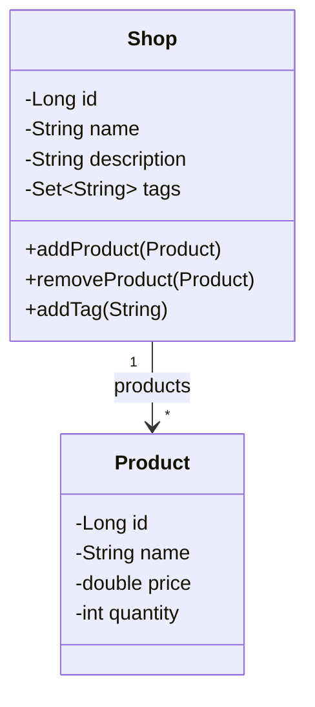

# Mini-Shopify

SYSC 4806 term project: a simplified Shopify built with Spring Boot, deployed on Azure.

Merchants create shops (name, description, categories/tags) and add products with a description, picture and inventory count. Customers search for shops by name or tag, browse a shop's catalog, add products to a cart and check out. Checkout is simulated, and a purchase can't exceed the available inventory.

**Live app:** 
**Kanban board:** 

## Tech stack

- Java, Spring Boot
- Spring Data JPA with Hibernate
- Thymeleaf 
- Maven, GitHub Actions, Azure App Service

## Team

| Member | Current focus |
|James Noel|x|
| Gabriel Bugarija | x |
| Yuvraj Bains | x |
| Declan Koster | x |
| Pranav Gupta | x |

## Current state (Milestone 1)

## Plan for next sprint (Milestone 2)

## Domain model

## Database schema
